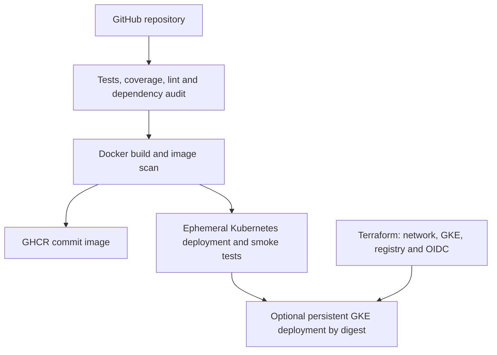
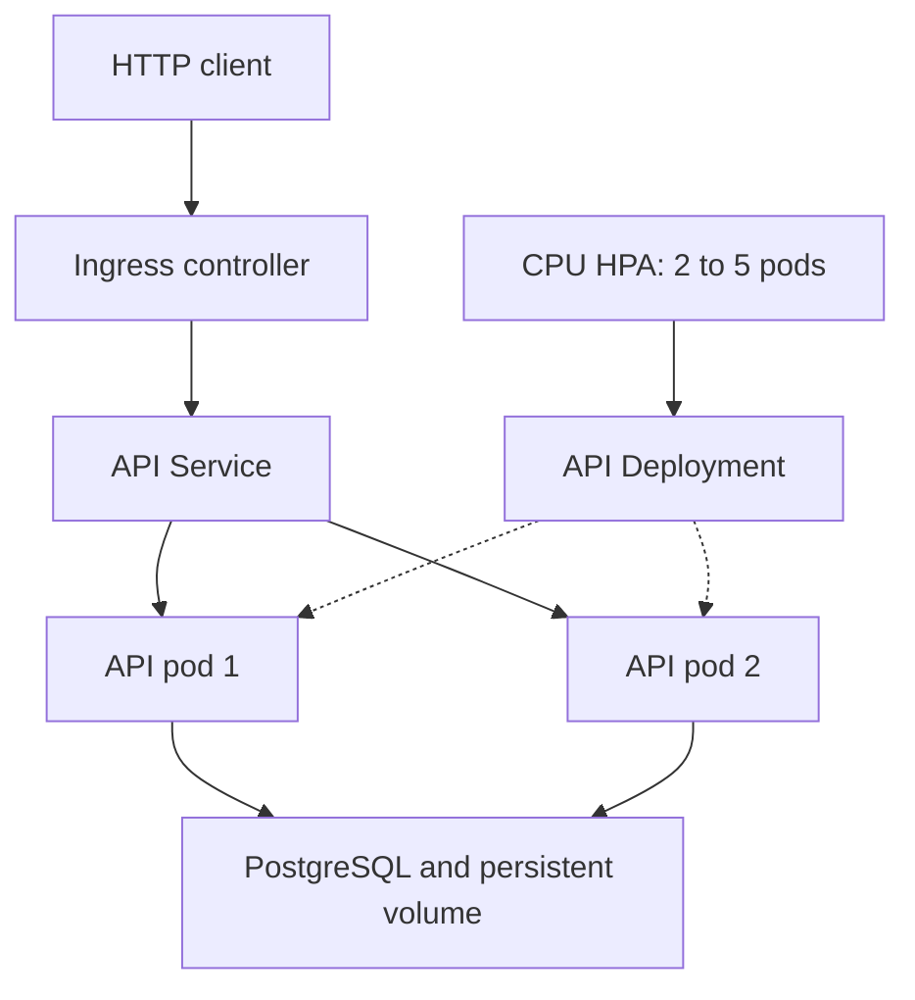

# Devsu DevOps technical assessment

Python starter from the supplied Devsu archive, extended with reproducible container builds,
quality gates, Kubernetes deployment, shared PostgreSQL persistence and optional GCP infrastructure.
The original user API and migration are retained. `POST /api/users/` returns **201** (the original
README incorrectly described 200). Duplicate DNI returns 400.

## Architecture





The default pipeline deploys to a real, temporary kind cluster, runs migrations, verifies ingress,
checks cross-pod persistence and CPU metrics, uploads evidence, then deletes the cluster. This is
an automated Kubernetes deployment, not a permanent public endpoint. Optional GKE CD deploys the
same tested image into a persistent cluster after kind succeeds.

## Quick start: Windows PowerShell / Docker Desktop

Prerequisites: Docker Desktop running with Linux containers; Python 3.12 for helper scripts.
Extract this project and open PowerShell in its root:

```powershell
py scripts/init-env.py
docker compose up --build -d
docker compose ps
curl.exe http://localhost:8000/health/ready/
py scripts/smoke.py http://localhost:8000
```

`init-env.py` creates random local credentials and refuses to overwrite an existing `.env`.
If Python is unavailable, copy `.env.example` to `.env`, replace both placeholders with random
values, and use Docker Compose; Python is needed only for the helper and smoke scripts.
Use a URL-safe PostgreSQL password (the helper generates hexadecimal passwords).

```powershell
docker compose logs api migrate db
docker compose down
```

The database persists in the named volume. `docker compose down -v` **deletes local database data**.
The API binds only to loopback on port 8000. SQLite remains available for bare Python development;
Compose and Kubernetes always use PostgreSQL.

## Python development and quality checks

On Linux/macOS (on Windows use `py -m venv .venv` and `.venv\Scripts\Activate.ps1`):

```bash
python3 -m venv .venv
source .venv/bin/activate
pip install -r requirements-dev.txt
python scripts/init-env.py
python manage.py collectstatic --noinput
python manage.py migrate --noinput
python manage.py runserver
```

In another activated terminal:

```bash
ruff check .
ruff format --check .
bandit -r api demo -x api/tests.py,api/migrations -ll
coverage run manage.py test
coverage report
coverage xml
python manage.py makemigrations --check --dry-run
pip-audit -r requirements.txt
```

CI runs tests against PostgreSQL. Coverage measures `api` runtime code, excluding tests,
migrations and framework registration; the 90% gate is **not** whole-project coverage.
Dependencies are pinned; the provider has a committed Terraform lock file.

## Container design

- Python 3.12, multi-stage build; build tooling is excluded from the final image.
- Gunicorn serves Django; WhiteNoise serves collected admin/DRF static assets.
- Fixed UID/GID 10001, dropped capabilities and a read-only API root filesystem.
- Configuration and secrets are injected at runtime; `.env` never enters the image.
- `/health/live/` checks the process; `/health/ready/` checks the database and returns 503 on failure.
- Container healthcheck uses the configurable `PORT`, default 8000.
- Schema changes run once in a dedicated Compose service or Kubernetes Job, not per API replica.

## CI/CD and registry

Workflow: `.github/workflows/ci-cd.yaml`.

| Stage | Gate / result |
| --- | --- |
| Quality | PostgreSQL tests, coverage >=90%, Ruff, Bandit, migration drift, pip-audit |
| Infrastructure | Terraform formatting, provider initialization and validation |
| Build | One Docker build; image vulnerability scan before publication |
| Publish | Push `ghcr.io/OWNER/REPOSITORY:COMMIT_SHA` on main/manual runs |
| Deploy kind | Migrations, rollout, ingress smoke, cross-pod persistence, HPA metrics |
| Deploy GKE | Optional OIDC login, Artifact Registry push and immutable digest deployment |

Pull requests run quality, build and kind deployment without publishing images or GCP access.
The image scan blocks **fixable HIGH/CRITICAL** vulnerabilities; the full report also retains
unfixed findings for review. The pipeline intentionally has no blanket vulnerability suppressions.
A new advisory may cause a previously green workflow to fail; update and rerun instead of removing gates.

Default jobs need no manually configured GitHub secrets. `GITHUB_TOKEN` is provided by GitHub;
only the build job has `packages: write`. Pull requests from forks do not publish packages.
The GKE job alone receives `id-token: write` and runs on `main` with `ENABLE_GKE_CD=true`.
Set Actions permissions to allow the built-in token to publish packages. After the first push,
open the GHCR package settings and set its visibility to public if reviewers should pull anonymously.

Evidence artifacts: `quality-reports`, `image-security-and-publication`, `kubernetes-evidence`.
The image artifact is retained for only 3 days; evidence uses repository retention defaults.

## Kubernetes locally

Prerequisites: Docker, kubectl, kind, Helm, Python and PyYAML; a default StorageClass is required.
The pipeline installs pinned kind, Traefik and metrics-server versions. For a manual local run:

```bash
pip install PyYAML==6.0.3
kind create cluster --name devsu --image kindest/node:v1.34.0 --config k8s/kind.yaml
docker build -t demo-devops:local .
kind load docker-image demo-devops:local --name devsu
helm repo add traefik https://traefik.github.io/charts
helm repo update
helm upgrade --install traefik traefik/traefik --version 37.1.1 --namespace ingress-system --create-namespace --set service.type=ClusterIP --wait
kubectl apply -f https://github.com/kubernetes-sigs/metrics-server/releases/download/v0.8.0/components.yaml
kubectl -n kube-system patch deployment metrics-server --type=json -p='[{"op":"add","path":"/spec/template/spec/containers/0/args/-","value":"--kubelet-insecure-tls"}]'
kubectl -n kube-system rollout status deployment/metrics-server --timeout=180s
python scripts/deploy.py
kubectl -n ingress-system port-forward svc/traefik 8080:80
```

The insecure kubelet TLS flag applies **only to local kind**; never add it in GKE.
In another terminal, run `python scripts/smoke.py http://localhost:8080` and
`python scripts/verify-cluster.py`. The smoke script sends `Host: demo.local` through ingress.
For a browser, add `127.0.0.1 demo.local` to your hosts file and use `http://demo.local:8080`.
Windows PowerShell JSON escaping differs; use these Kubernetes commands in WSL/bash,
or rely on GitHub Actions for the equivalent automated run.

`python scripts/deploy.py` renders Kustomize, creates missing demo secrets, waits for PostgreSQL,
runs migrations, and only then applies the API/HPA/PDB/Ingress. Existing secrets are preserved.
The pipeline serializes runs per branch; do not run concurrent manual deployments to the same cluster.
For a new manual deployment, set `IMAGE` to a registry digest or unique commit tag; do not reuse
`demo-devops:local` for updates, as an unchanged image reference does not trigger a rollout.

```bash
kubectl -n devsu get deployments,pods,svc,ingress,hpa,pdb,pvc
kubectl -n devsu top pods
kubectl -n devsu describe hpa demo-api
kubectl -n devsu logs job/demo-migrate
```

The API has at least 2 replicas, CPU requests/limits, HPA 2–5, probes, a PDB and rolling updates
with zero unavailable pods. PostgreSQL is a single-instance StatefulSet with a PVC: persistent,
but **not highly available**. HPA metrics availability is tested; an actual load-driven scaling
experiment remains a separate evidence task (see `docs/EVIDENCE.md`).

## Optional GCP infrastructure and deployment

Read [GCP setup](docs/GCP.md) before applying Terraform. It creates billable resources; no cloud
resources have been created by this deliverable. Use a dedicated demo project, not a work project.

```bash
cd infra/gcp
cp terraform.tfvars.example terraform.tfvars
# Fill project, exact repository name and immutable numeric repository ID.
terraform init
terraform fmt -check
terraform validate
terraform plan -out=demo.tfplan
terraform apply demo.tfplan
terraform output
```

Copy the `github_variables` output into repository Actions variables, create the `gke-demo`
environment restricted to `main`, and then set `ENABLE_GKE_CD=true`. Optional environment approval
rules are configured by the repository owner. Persistent GKE deployment remains disabled by default.

## Security and production boundaries

This assessment retains the starter's unauthenticated CRUD API and uses synthetic test data.
Do not publish real DNI or personal data. A production deployment needs authentication,
authorization, TLS, backups/restore testing, database HA, network policy and secret rotation.

The local ingress uses Traefik, avoiding the retired community ingress-nginx controller.
The GKE overlay uses the GKE-managed `gce` ingress and a wildcard Django host list solely to support
an unknown demo load-balancer IP. Before production, restrict `DJANGO_ALLOWED_HOSTS` to the DNS name,
configure DNS/TLS, set `COOKIE_SECURE=True`, and evaluate HSTS and trusted proxy settings.
`TRUST_PROXY` defaults to false. Enable it only when the proxy overwrites forwarded protocol headers.

The GKE deployer uses project-level `roles/container.developer` in the dedicated demo project,
not Owner/Editor. A production setup should replace that broad deployment scope with namespace
RBAC and separately bootstrap the namespace. Neither service account has a downloaded JSON key.
Kubernetes Secrets are encoded, not a dedicated secret-management system.
The demo's automatically generated Secret is intended for evaluation; use a managed secret backend
and a coordinated database credential rotation procedure for production.

Images and Helm chart versions are pinned by version/tag for the demo. Application dependencies
and Terraform providers are locked. GitHub Actions are pinned to resolved commit SHAs. Base/container infrastructure image digests and download
checksums should also be locked under an update process for stronger supply-chain reproducibility.

## Submission and validation status

See [validation performed](docs/VALIDATION.md), [evidence checklist](docs/EVIDENCE.md), and
[Spanish quick start](docs/QUICKSTART-ES.md).

Required hand-in: public GitHub repository URL, ZIP and real pipeline execution URL/screenshots.
A public endpoint is optional. Cloud IaC extra points require actual `terraform apply`/`output`
evidence, not merely Terraform source files. Never represent the included local checks as a completed
GitHub Actions, Docker or cluster execution.

## Original attribution

Derived from the supplied `devsu-demo-devops-python.zip` starter.
Original notice: Copyright © 2023 Devsu. All rights reserved.
The assessment explicitly asks the candidate to publish the generated solution in GitHub.
