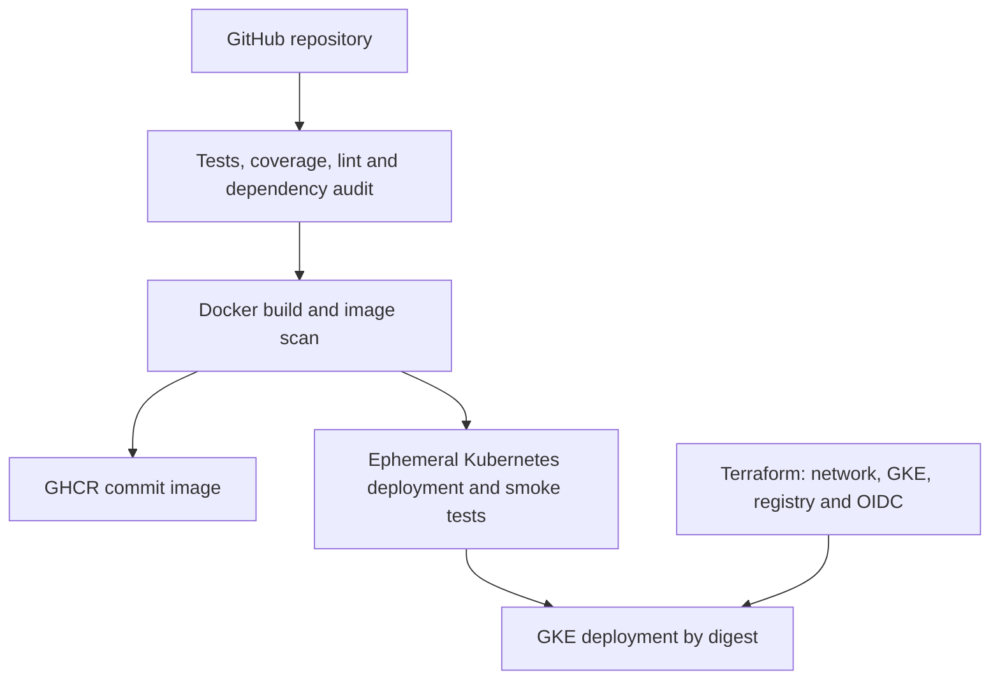
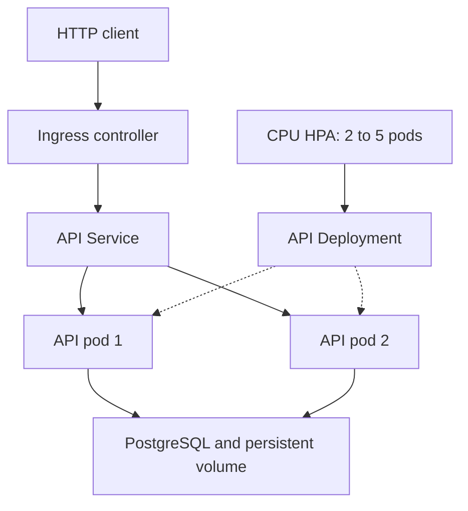

# Devsu DevOps Technical Assessment

**Author: Aldemaro Cruz**

Django REST API deployed on Google Kubernetes Engine (GKE), with PostgreSQL, Docker, GitHub Actions and Terraform.

## Architecture





GitHub Actions runs tests and security checks, builds the image, validates deployment in kind, and deploys to GKE. The Ingress routes requests to two API replicas sharing PostgreSQL; the HPA scales the API from 2 to 5 replicas based on CPU usage.

## CI/CD and security

| Stage | Checks and actions |
| --- | --- |
| CI | Tests against PostgreSQL, API coverage >=90%, Ruff lint/format checks, and migration drift detection. |
| Infrastructure validation | Terraform formatting, provider initialization and validation. Infrastructure provisioning uses a separate Terraform apply from Cloud Shell. |
| Build and publication | Builds the Docker image, scans it, and publishes it to GHCR using the commit SHA. |
| Kubernetes validation | Deploys to kind and checks migrations, ingress, two Ready API pods, shared data and HPA CPU metrics. |
| CD | After validation succeeds, publishes the tested image to Artifact Registry, runs migrations and deploys to GKE by digest, waiting for the rollout. |

| Security tool | Scope |
| --- | --- |
| Bandit | Static security analysis of the Python application. |
| pip-audit | Known vulnerabilities in Python runtime dependencies. |
| Trivy | Known vulnerabilities in OS packages and application dependencies inside the Docker image. |

Trivy blocks publication for **fixable HIGH/CRITICAL vulnerabilities**. Its full report includes unfixed findings and is available as `trivy.json` in the Actions artifact `image-security-and-publication`. Pull requests run validation without publishing images or deploying to GKE; GKE deployment is enabled on `main` through `ENABLE_GKE_CD=true`.

## Public endpoints

| Endpoint | URL | Behavior |
| --- | --- | --- |
| Users API | [http://136.82.26.191/api/users/](http://136.82.26.191/api/users/) | `GET` lists users. `POST` creates a user from `name` and `dni`, returning HTTP 201. Use `/api/users/<id>/` to retrieve, update or delete a user. |
| Readiness | [http://136.82.26.191/health/ready/](http://136.82.26.191/health/ready/) | Checks database connectivity. Returns HTTP 200 with `{"status":"ready"}`, or HTTP 503 when the database is unavailable. |

## Run locally

With Docker Desktop running and Python installed, execute from the project directory in PowerShell:

```powershell
py scripts/init-env.py
docker compose up --build -d
py scripts/smoke.py http://localhost:8000
```

Run `init-env.py` only on first setup; it creates `.env` with random credentials. Locally, the same endpoints are available at `http://localhost:8000`. The smoke test checks health endpoints and creates, retrieves, lists and deletes a synthetic user. Stop the containers with `docker compose down`.

## Validate the public deployment

```bash
python3 scripts/smoke.py http://136.82.26.191
```

[Repository](https://github.com/AldemaroCruz/devsu-devops) · [Pipeline runs](https://github.com/AldemaroCruz/devsu-devops/actions)

*Based on the Devsu Python starter. Original copyright © 2023 Devsu.*
